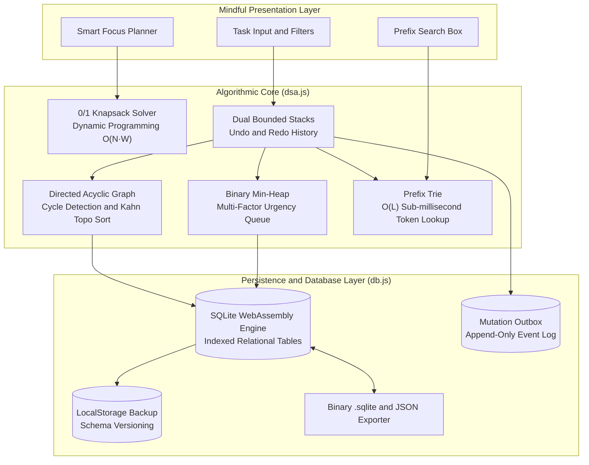

<div align="center">

  

  # Checklist

  <p align="center">
    <strong>An elegant, mindful to-do list & focus engine engineered with Computer Science rigor.</strong><br />
    <em>Powered by Data Structures & Algorithms, SQLite WebAssembly, and production-grade Local-First System Design.</em>
  </p>

  <p align="center">
    <a href="https://deadheaven07.github.io/Check_List/"></a>
    <a href="https://github.com/deadheaven07/Check_List/actions"></a>
    <a href="https://sqlite.org/"></a>
    <a href="https://developer.mozilla.org/en-US/docs/Web/Progressive_web_apps"></a>
  </p>

  <p align="center">
    <a href="#-key-features">Key Features</a> •
    <a href="#-system-architecture">System Architecture</a> •
    <a href="#-under-the-hood-dsa">Under-the-Hood DSA</a> •
    <a href="#-sqlite-relational-engine">SQLite Engine</a> •
    <a href="#-quick-start">Quick Start</a> •
    <a href="#-automated-testing">Testing</a>
  </p>

  ---
</div>

## 🌟 Overview

**Checklist** is a distraction-free, aesthetically crafted productivity sanctuary designed to help you accomplish your most meaningful work with serenity. 

Behind its warm pastel gradients and silky micro-interactions lies an advanced **Local-First Distributed System**:
- **Zero UI Jargon**: No developer complexity is exposed to the user. Tasks simply organize themselves with effortless intelligence.
- **Relational Persistence**: Uses **in-browser SQLite compiled to WebAssembly** alongside localStorage fallback and direct `.sqlite` binary database export.
- **Computer Science Core**: Powers task scheduling with **DAG Topological Sort**, **Min-Heaps**, **Prefix Tries**, and **0/1 Knapsack Dynamic Programming**.
- **Offline-First Resilience**: An installable **Progressive Web App (PWA)** that runs smoothly without an internet connection.

---

## ✨ Key Features

<table>
  <tr>
    <td width="50%">
      <h3>🌸 Mindful Aesthetic Design</h3>
      <ul>
        <li>Radiant ambient mesh lighting & glassmorphism cards</li>
        <li>Haptic-like confetti bursts & fluid state transitions</li>
        <li>Synthesized ambient audio (Soft Rain, Stream, White Hum)</li>
        <li>Native Web Audio sound effects with zero external audio assets</li>
      </ul>
    </td>
    <td width="50%">
      <h3>🧠 Silent Algorithmic Scheduling</h3>
      <ul>
        <li>Prerequisites automatically bubble before dependent tasks</li>
        <li>Composite urgency Min-Heap prioritizes high-impact goals</li>
        <li>Dynamic Programming packs the optimal tasks into focus blocks</li>
        <li>Prefix Trie delivers instantaneous sub-millisecond search</li>
      </ul>
    </td>
  </tr>
  <tr>
    <td width="50%">
      <h3>🗄️ SQLite Relational Engine</h3>
      <ul>
        <li>Client-side WebAssembly SQL query execution</li>
        <li>Single-click binary <code>.sqlite</code> / <code>.db</code> export & import</li>
        <li>B-tree indexed relational tables with ACID transaction semantics</li>
        <li>Automatic dual-engine fallback (Node.js <code>DatabaseSync</code> in CI)</li>
      </ul>
    </td>
    <td width="50%">
      <h3>🛡️ Production-Hardened Resilience</h3>
      <ul>
        <li>Full 50-step Undo / Redo history via the Command Pattern</li>
        <li>Append-only Mutation Outbox for sync durability</li>
        <li>Stale-While-Revalidate Service Worker caching</li>
        <li>Global crash boundary catching runtime errors gracefully</li>
      </ul>
    </td>
  </tr>
</table>

---

## 🏗️ System Architecture

Checklist operates as a reactive, local-first engine where algorithmic models feed directly into the relational layer:



---

## 🔬 Under-the-Hood DSA

All algorithms execute in the client background with optimal time and space complexity:

| Engine Component | Data Structure / Algorithm | Complexity | Purpose |
| :--- | :--- | :--- | :--- |
| **Prerequisite DAG** | Directed Acyclic Graph + DFS | $\mathcal{O}(V + E)$ | Detects dependency cycles (`A ➔ B ➔ A`) and enforces lock badges (`🔒 Needs: [Prerequisite]`). |
| **Topological Sort** | Kahn's Algorithm (In-degree queue) | $\mathcal{O}(V + E)$ | Automatically sorts foundational tasks ahead of downstream blockers. |
| **Urgency Scheduler** | Binary Min-Heap | $\mathcal{O}(\log N)$ push/pop | Balances priority, energy level, and due-date proximity for $\mathcal{O}(1)$ top-task peek. |
| **Instant Search** | Prefix Trie (Prefix Tree) | $\mathcal{O}(L)$ lookup | Instant character-by-character search across titles and category tags. |
| **Smart Day Planner** | 0/1 Knapsack (Dynamic Programming) | $\mathcal{O}(N \cdot W)$ | Optimally packs tasks into dedicated focus slots (30m, 60m, 120m, 240m) maximizing productivity score. |
| **Action History** | Command Pattern + Dual Stacks | $\mathcal{O}(1)$ Undo/Redo | Granular `Cmd+Z` / `Cmd+Y` state rollback up to 50 operations deep. |

---

## 🗄️ SQLite Relational Engine

Checklist features a production-ready relational database implementation in [`db.js`](db.js):

### Relational Schema & B-Tree Indexes
```sql
CREATE TABLE IF NOT EXISTS tasks (
  id TEXT PRIMARY KEY,
  title TEXT NOT NULL,
  category TEXT NOT NULL,
  priority TEXT NOT NULL,
  energy TEXT NOT NULL,
  completed INTEGER NOT NULL DEFAULT 0,
  created_at INTEGER NOT NULL,
  due_date TEXT,
  depends_on TEXT
);

CREATE INDEX IF NOT EXISTS idx_tasks_completed  ON tasks(completed);
CREATE INDEX IF NOT EXISTS idx_tasks_priority   ON tasks(priority);
CREATE INDEX IF NOT EXISTS idx_tasks_due_date   ON tasks(due_date);
CREATE INDEX IF NOT EXISTS idx_tasks_created_at ON tasks(created_at);
```

### Key Database Features
* **WebAssembly Execution**: Direct SQL queries (`SELECT`, `INSERT`, `UPDATE`, `DELETE`) executed inside the browser thread using `sql.js`.
* **Zero-Loss Binary Backup**: Exports true `.sqlite` binary database files compatible with `sqlite3` CLI, DB Browser for SQLite, and TablePlus.
* **Dual-Environment Support**: Seamlessly uses Node 22's native `DatabaseSync` (`node:sqlite`) during automated terminal testing, and WebAssembly in browsers.

---

## 📁 Repository Structure

```
Check_List/
├── index.html            # Semantic, accessible HTML5 single-page application
├── style.css             # Radiant pastel styling, glassmorphism, responsive grid
├── app.js                # UI orchestration, sound synthesizer, state controller
├── dsa.js                # Standalone DSA classes (DAG, Heap, Trie, Knapsack, Stacks)
├── db.js                 # Dual-environment SQLite relational storage engine
├── sw.js                 # PWA Service Worker (Stale-While-Revalidate caching)
├── manifest.json         # Web App Manifest for native OS installation
├── logo.svg              # Minimalist gradient vector branding mark
├── test.js               # Zero-dependency algorithmic & database test suite
└── .github/
    └── workflows/
        └── ci.yml        # CI/CD: Node 22 syntax check, tests & GitHub Pages deploy
```

---

## 🚀 Quick Start

### 1. View in Browser
Checklist requires **no build step** and **no package managers**. Simply open the file:
```bash
# macOS
open index.html

# Linux
xdg-open index.html

# Windows
start index.html
```

### 2. Run Local Development Server
To test PWA Service Worker registration and SQLite WebAssembly loading:
```bash
# Using Python
python3 -m http.server 3000

# Using Node.js
npx serve .
```
Navigate to **`http://localhost:3000`** in your browser.

---

## 🧪 Automated Testing

Checklist includes a comprehensive, standalone test suite with **15 automated test specifications** covering all algorithmic invariants and database transactions:

```bash
node test.js
```

### Test Suite Output
```text
============================================================
🧪 CHECKLIST • ALGORITHMIC & RESILIENCY TEST SUITE
============================================================
  ✔ [PASS] PriorityQueue: Min-heap invariant maintained across insertions & extractions
  ✔ [PASS] PriorityQueue: Peek returns top priority element without mutation
  ✔ [PASS] DependencyGraph: Cycle detection prevents circular dependencies
  ✔ [PASS] DependencyGraph: Multi-node indirect cycle detected
  ✔ [PASS] DependencyGraph: Kahn's topological sort orders prerequisites before dependents
  ✔ [PASS] PrefixTrie: Exact and prefix matches return correct items
  ✔ [PASS] PrefixTrie: Item removal cleanly prunes trie nodes
  ✔ [PASS] KnapsackSolver: Optimal subset selection maximizes score within capacity
  ✔ [PASS] KnapsackSolver: Handles empty sets or zero capacity without crashing
  ✔ [PASS] CommandHistory: Undo and redo correctly restore task states
  ✔ [PASS] CommandHistory: Boundary stack capacity properly evicts old states
  ✔ [PASS] MutationOutbox: Transactions append and drain cleanly
  ✔ [PASS] SQLiteEngine: Relational schema creation and parameter-bound task CRUD
  ✔ [PASS] SQLiteEngine: Dependency filtering via relational queries
  ✔ [PASS] SQLiteEngine: Binary export and in-memory roundtrip validation

============================================================
📊 Test Summary: 15 Passed, 0 Failed, 15 Total
============================================================
```

---

## 🌐 Deployment

Checklist is continuous-integration ready:
* **GitHub Actions Workflow** ([`.github/workflows/ci.yml`](.github/workflows/ci.yml)): Runs syntax verification and `test.js` under Node 22 on every push.
* **GitHub Pages Ready**: Can be served from the `main` or `gh-pages` branch with zero server setup.
* **Static Hosting Ready**: Fully compatible with Vercel, Netlify, Cloudflare Pages, or AWS S3.

---

## 📄 License

Open-source under the [MIT License](LICENSE). Built with ❤️ for mindful focus and clean code.
